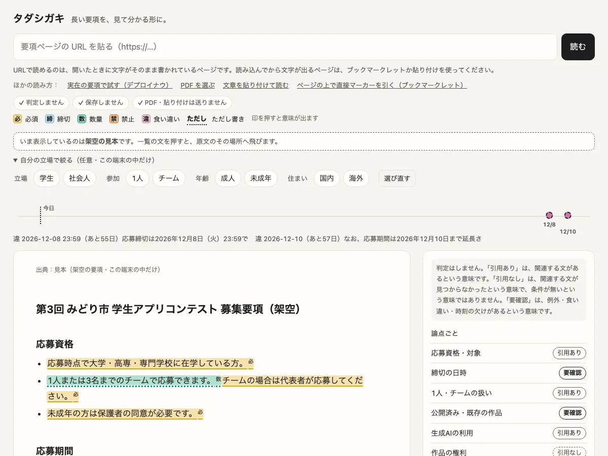

# Skimlight

コンテストの応募要項や奨学金の募集要項のような長い規則を、原文のまま見落とさずに読むための道具。判定はしない。原文の該当箇所を並べ、決めるのは読む人に任せる。



このリポジトリには2つの版が入っている。

| 場所 | 中身 |
|---|---|
| `web/` | Web版。要項のURL・PDF・貼り付けた文章を読み、締切・必須・数量・禁止・食い違いの文に5色の印を付ける。使い方は [web/README.md](web/README.md) |
| `ruleaudit/` | 手元で動かすコマンド版。要件カードと自分の状況を突き合わせ、「引用あり／引用なし／要確認」の3つで返す |

## 考え方

- 判定はしない。結果の語は「引用あり」「引用なし」「要確認」の3つだけで、決めるのは使う人。
- 「引用あり」になるのは、引用が取得した原文と一字ずつ一致した時だけ。カードを書いた人やAIの申告は、そのままでは信じない（`ruleaudit/quotes.py`）。
- 3つのどれにするかは、プログラムの規則だけで決める（`ruleaudit/adjudicate.py`）。
- 自分の状況は端末のJSON（`.private/situation.json`。gitの外）に置き、ネットワークへ出さない。原文を取りに行くモジュールは状況をimportしない（テストで確かめている）。
- 外へ出る通信はGETだけ。httpsの公開ホストにだけ接続し、転送は追わない。同じホストへは3秒あけて取りに行く。

## コマンド版の使い方

Python 3.13以上の標準ライブラリだけで動く。読み込んでから文字が出るページを取るときは、端末のGoogle Chromeをヘッドレスで使う。

```bash
python3 -m ruleaudit situation init                # 状況の雛形を .private/situation.json に作る（既にあれば上書きしない）
python3 -m ruleaudit situation check               # 型の誤りと、カードが使うのに空の項目を出す（値は表示しない）
python3 -m ruleaudit list                          # 題材と、取得した原文の控えの一覧
python3 -m ruleaudit fetch                         # 原文を取得して控えを .cache/ に残す（題材を省くと全部）
python3 -m ruleaudit summary                       # 題材ごとの3値の件数と、次の締切
python3 -m ruleaudit deadlines                     # 締切の要件を日付順に並べる
python3 -m ruleaudit audit <題材ID>                # 要件と状況を突き合わせて3値を出す（ネットワークを使わない）
python3 -m ruleaudit audit --only 要確認           # 要確認だけを出す
python3 -m ruleaudit watch --quiet                 # 原文を取り直し、変わった所と影響する要件を出す
python3 -m ruleaudit registry find <registry.json> --area 131016 --age 3
python3 -m ruleaudit registry card <registry.json> <psid> <subject_id>
python3 -m unittest discover -s tests -t .         # テスト（ネットワークを使わない）
```

`watch` の終了コードは、変化ありが3、取得の失敗だけが4、変化なしが0。記録は `.cache/watch-log.jsonl` に残る。

`registry` は、東京都の子育て支援制度レジストリ（CC BY 4.0）のJSONを手元に保存して使う。`find` で制度を探し、`card` で制度ごとの要件カードを作る。

## 3値の決め方

| 結果 | 条件 |
|---|---|
| 引用あり | 引用が原文と一字ずつ一致し、理由コードが1つも付かなかった |
| 引用なし | カードが「記載なし」としていて、裏取りの語（`absent_terms`）も原文に無かった |
| 要確認 | それ以外。必ず理由コードを付ける |

理由コード：控えが無い／引用が原文に無い／引用が短すぎる／引用の前後に条件・例外・否定の語がある／引用に条件・例外の語があり、数値を並べるだけでは扱えない／状況に値が無い／範囲から外れて見える／型が合わない／締切を過ぎた／「記載なし」なのに関連する語が原文にある／カードを作った後に原文が変わった。

状況の値と要件の数値は、「並べた結果（判断ではありません）」として注記に出す。範囲から外れて見える時は「要確認」にする。

## 自分の状況（`.private/situation.json`）

項目と型の定義は `ruleaudit/situation.py` のFIELDSにある（日付・真偽・整数・文字列）。分からない項目はnullのままでよく、その項目を使う要件は「要確認（状況に値が無い）」になる。架空の例は `examples/situation.example.json`。

要件カードのcheckで使えるのは、FIELDSにある項目だけ。打ち間違えた項目は、カードを読み込む時に止まる。

## 要件カード（`subjects/*.json`）

要件カードは `subjects/` に置く（このリポジトリには入れていない）。形は `ruleaudit/cards.py` のdocstringにある。いまは人かAIが原文を読んでカードを書き、引用が原文にあるかはツールが照合する。モデルで要件を取り出す処理はまだ無い。入れる場合も、その出力は同じ照合を通す。

出典ごとに `scope_start` と `scope_end`（控えに残す範囲の目印）を置ける。広告や関連記事の枠を、差分の監視から外すために使う。目印が見つからない時は、切らずに全文を残す。

## 扱わないこと

- 税・社会保険の判断。無償でも個別の税務相談は税理士法52条に当たるため、原文を示すことと計算機までにとどめる。
- 書類の作成代行。

## ライセンス

Apache License 2.0（[LICENSE](LICENSE)）。移植したコード・依存・データの出所は [NOTICE.md](NOTICE.md) に書いた。
